# Bloodborne · DLSS 5 NRBridge

<p align="center">
  <strong>English</strong> · <a href="README.zh-CN.md">简体中文</a> · <a href="README.ru.md">Русский</a>
</p>


<p align="center">
  <strong>Return to Yharnam. On Linux.</strong><br>
  DLSS 5 NR · DLSS SR · DLSS FG/MFG 2X–6X · Native keyboard &amp; mouse · Full launcher
</p>

<p align="center">
  <a href="#features">Highlights</a> · <a href="#getting-started">Get started</a> ·
  <a href="#how-it-works">How NRBridge works</a> · <a href="#docs">Build &amp; docs</a>
</p>

**NRBridge brings DLSS 5 NR to Bloodborne’s native Linux port.**
Built on [bbport 0.6](https://github.com/deadinside28/bloodborne_pc), this fork connects
independent NR inference to native DLSS SR, alongside native mouse input, composite
key bindings, Chinese settings and save management—all accessible from the full launcher.


<p align="center"><sub>Captured in-game with NR enabled. The bottom-right overlay shows the live NR state.</sub></p>

<a id="features"></a>

**NR, super resolution and frame generation share one launcher and can be controlled independently.**
Choose AMD FSR x2 or NVIDIA DLSS FG/MFG 2X–6X, with multiple resolutions,
SR presets and Old/New memory. NR-only + FG is supported. New memory is the default,
with Old available for comparison; the default NR history policy is Legacy.
Smooth Motion remains unavailable pending safe shutdown validation.

See the [player guide](docs/PLAYER_GUIDE.zh-CN.md), [current features](docs/PC_FEATURES.zh-CN.md),
[project status](docs/PROJECT_STATUS.zh-CN.md) and [roadmap](docs/NRBRIDGE_ROADMAP.zh-CN.md).
These guides are currently in Chinese.

## Bring NR and frame generation to Yharnam

| 🟢 NR + DLSS SR | 🌙 Persistent visual history |
| :--- | :--- |
| A separate Helper runs the NR model and feeds its results back into native rendering, with in-game NR controls. | NR results are retained and refreshed across frames, supplying valid visual history to subsequent SR frames. |
| **🖱️ Native keyboard & mouse** | **🎛️ The full launcher** |
| Direct camera control, a menu pointer, composite bindings, button prompts and Chinese settings. | Graphics, input, Mods/patches, online options and saves in one place, with automatic backups and restore. |

Also retained from bbport 0.6: controller support, aspect ratios and in-game graphics
settings, DLC/content mounting, and **21 game-language choices**; actual translations
depend on your game files.

The Hunter’s Dream, Seamless Hunt and optional BBSC entry points are also integrated.

### DLSS 5 Neural Rendering

- Enter a playable scene and press F8 to enable NR, then toggle its effect to compare the same scene.
- Pair NR with native DLSS SR, or turn off upscaling for NR-only; frame generation has its own switch.
- Choose the model preset, NR processing resolution and effect strength to suit your preferences.
- Persistent visual history retains and refreshes NR results across real frames, keeping asynchronous inference part of the picture.

### NVIDIA DLSS FG / MFG 2X–6X

This fork adds DLSS FG as an alternative to the position jumps seen in FSR-generated frames.

In local gameplay comparisons, switching to DLSS FG delivered performance comparable to
FSR 3 FG without reproducing the flicker caused by those texture-position jumps.
FSR FG remains selectable for comparison.

With the FSR 3 frame generation used in upstream 0.6, textures and vegetation can
repeatedly jump in position and cause flicker. This fork has not fixed that FSR issue either.

- Select NR, SR and FG separately; frame generation also works with NR disabled.
- Adjust the output resolution, SR preset and aspect ratio to suit your display and preferences.
- Supported DLSS GPU configurations let you change the multiplier in-game; options requiring a restart say so.
- The HUD separates real, generated and application Present rates to help compare settings.

AMD FSR x2 remains available, alongside an experimental FSR 3.1.6 implementation.

<a id="getting-started"></a>

## Start your hunt

### You will need

- Linux x86-64 and a compatible Vulkan driver.
- Your own **Bloodborne game files with update 1.09**.
- For NR or NVIDIA DLSS FG: a compatible NVIDIA GPU, the required runtime and matching Helpers.
- NR models, DLLs and game files are user-provided dependencies; they are not included in this repository.

For source setup and dependencies, see the [developer guide](tools/nr_dev/README.md).
Helper build instructions are in [NRBridge](nrbridge/README.md).

### Launch

With a prepared AppImage or installation, open the AppImage or `./launch.sh`:

1. Open the installed launcher and keep your existing game and save directories. Source setup is covered in the developer guide.
2. Select NR, SR, output resolution and frame generation independently.
3. Start the game, enter a controllable scene, then press **F8** to enable NR without returning to the launcher or confirming again.
4. When finished, wait for your progress to finish saving before closing the launcher.

<details>
<summary><strong>Hotkeys and graphics setup</strong></summary>

| Key | Action |
| :--- | :--- |
| F1 | Release mouse capture; click the game to recapture |
| F6 | Toggle the offline free camera; no multiplayer or BBSC requirement |
| F8 | First press enables NR in-game; later presses toggle the NR effect |
| Delete | Open NR and graphics settings |
| Insert / L3+R3 | Open bbport settings |

The HUD distinguishes real, generated and application Present rates. Present counts
are not the number of frames actually shown by the display. F8, the active FG switch,
and 2X–6X multiplier changes in supported DLSS GPU configurations take effect live.

DLAA, Quality, Balanced and Performance support multiple outputs and aspect ratios.
Upscaler Off selects NR-only when NR is enabled. NR processing resolution is separate
from display resolution. Keep jitter and object motion vectors enabled for NR.
Normal play disables validation, performance profiling and diagnostic image sampling.

</details>

<details>
<summary><strong>Known issues and compatibility</strong></summary>

- NR shading flicker, valid-history drops and bright trails can still occur.
- Community messages, bloodstains, phantoms and BBSC multiplayer are undergoing validation; controller, real-DLC and wider-area coverage is also expanding.
- Smooth Motion is unavailable; safe shutdown and resource retirement have not passed validation.
- Higher MFG multipliers add GPU work and VRAM usage and may lower real FPS. More generated frames do not necessarily mean lower input latency.
- Some current AppImage dependencies require GLIBC 2.44; compatibility with older distributions needs further work.
- The launcher does not currently offer FSR 4.1.1 DLL conversion. Prepared resources remain selectable when the GPU meets the requirements.

See the [current features and limitations](docs/PC_FEATURES.zh-CN.md).
Historical development reports remain available for developers.

</details>

<a id="how-it-works"></a>

## How NRBridge fits into the game

The game and Vulkan rendering continue to run natively on Linux. NRBridge brings
separate model inference back into the game image, followed by native rendering or
DLSS SR. With DLSS FG enabled, another independent path generates intermediate frames.

[](docs/assets/nrbridge-dlss-architecture.svg)

The diagram uses Chinese labels and separates Native Linux rendering from two Wine
Helpers. Native DLSS SR comes from bbport; this fork adds NR integration, persistent
visual history and NVIDIA FG/MFG integration. Click the image for the full-size diagram.

NR inference runs as sparse asynchronous jobs while persistent visual history advances
with real game frames. Generated frames do not advance NR/SR real-frame history.

Inference currently uses Wine Helpers. **NR running directly on native Vulkan without
Wine remains a separate research direction and is not part of the player runtime.**

<a id="docs"></a>

## Build and explore

The default branch is **`nrbridge`**:

```bash
git clone --recursive --branch nrbridge \
  https://github.com/Asanilo/bloodborne-pc-dlss5-nr.git
```

| Looking for | Start here |
| :--- | :--- |
| Playing and settings | [Player guide](docs/PLAYER_GUIDE.zh-CN.md) (Chinese) |
| Current features and limitations | [Feature overview](docs/PC_FEATURES.zh-CN.md) (Chinese) |
| Project status and validation scope | [Project status](docs/PROJECT_STATUS.zh-CN.md) (Chinese) |
| Dependencies, Native and Helper builds | [Developer guide](tools/nr_dev/README.md) |
| NR Helper architecture and build | [NRBridge](nrbridge/README.md) |
| AppImage packaging | [Package guide](packaging/nrbridge/README.md) |
| Future directions | [Roadmap](docs/NRBRIDGE_ROADMAP.zh-CN.md) (Chinese) |

## Credits

Thanks to [bbport](https://github.com/deadinside28/bloodborne_pc),
[shadPS4](https://github.com/shadps4-emu/shadPS4) and the contributors to the related
open-source projects. See [component credits](gpu/VENDOR.txt) and [LICENSE](LICENSE).

Bloodborne belongs to its respective rights holders. This project is not affiliated
with Sony Interactive Entertainment, FromSoftware, NVIDIA or AMD. Game files,
proprietary models and NVIDIA DLLs are not included in this repository.
