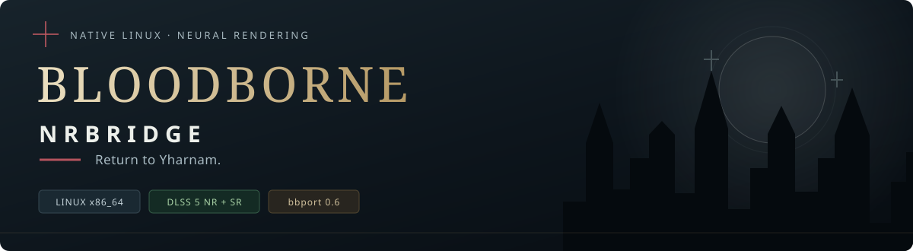
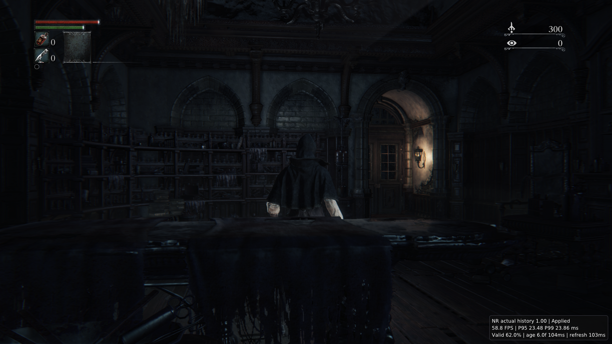

# Bloodborne · DLSS 5 NRBridge

<p align="center">
  <a href="README.md">English</a> · <a href="README.zh-CN.md">简体中文</a> · <strong>Русский</strong>
</p>



<p align="center">
  <strong>Возвращение в Ярнам. На Linux.</strong><br>
  DLSS 5 NR + DLSS SR · Нативная камера мышью · Постоянная визуальная история · Полный лаунчер
</p>

<p align="center">
  <a href="#features">Возможности</a> · <a href="#getting-started">Начать игру</a> ·
  <a href="#how-it-works">Как это работает</a> · <a href="#docs">Сборка и документация</a>
</p>

**NRBridge добавляет DLSS 5 NR в нативный Linux-порт Bloodborne.**
На основе [bbport 0.6](https://github.com/deadinside28/bloodborne_pc) этот форк
соединяет отдельное выполнение NR-модели с нативным DLSS SR, сохраняя прямое управление
мышью, составные привязки клавиш, китайские настройки и управление сохранениями
в полном лаунчере.



<p align="center"><sub>Кадр из игры с включённым NRBridge. Справа внизу — текущее состояние NR.</sub></p>

<a id="features"></a>

**NR, масштабирование и генерация кадров доступны независимо в одном лаунчере.**
Поддерживаются AMD FSR x2, NVIDIA DLSS FG/MFG 2X–6X, разные разрешения,
пресеты SR, Old/New и NR-only + FG. По умолчанию используются New и Legacy NR.
Smooth Motion недоступен до проверки безопасного завершения.
Локальная установка отделена от разработки; обновление сохраняет настройки,
сохранения и предыдущую версию. Публичный бинарный выпуск пока не публикуется.
[Руководство игрока](docs/PLAYER_GUIDE.zh-CN.md).

## Новый путь рендеринга для Ярнама

| 🟢 NR + DLSS SR | 🌙 Постоянная визуальная история |
| :--- | :--- |
| Отдельный Helper выполняет NR-модель и возвращает результат в нативный рендеринг; параметры NR доступны в игре. | Результаты NR сохраняются и обновляются между кадрами, предоставляя пригодную историю следующим SR-кадрам. |
| **🖱️ Нативные клавиатура и мышь** | **🎛️ Полный лаунчер** |
| Прямое управление камерой, указатель в меню, составные привязки, подсказки кнопок и китайские настройки. | Графика, ввод, моды/патчи, сеть и сохранения в одном месте, с автоматическими резервными копиями и восстановлением. |

Сохранены возможности bbport 0.6: геймпады, соотношения сторон и графические настройки
в игре, подключение DLC/контента и **21 вариант языка игры**; тексты зависят от
ваших игровых файлов. The Hunter’s Dream, Seamless Hunt и опциональный BBSC
интегрированы; проверка сетевого контента продолжается.

**Уже работает в игре:** NR, нативная мышь, возврат из сцены и титульного экрана,
запись и повторная загрузка сохранений, штатный выход. Игрок подтвердил более
отзывчивую камеру, правильную остановку мыши, освобождение по F1 и возврат из меню.

<a id="getting-started"></a>

## Начните охоту

### Что понадобится

- **Linux x86-64**, совместимая видеокарта NVIDIA и драйверы с Vulkan/NGX.
- Собственные игровые файлы **Bloodborne 1.09**.
- Локальный Wine/GE, NR-модель и совместимые Helper/forwarder;
  см. [подготовку зависимостей и сборку](tools/nr_dev/README.md).

### Запуск

В подготовленной установке откройте AppImage или `./launch.sh`:

1. Откройте установленный лаунчер и сохраните свои папки игры и сохранений.
2. Выберите NR, SR, разрешение и FG независимо; начните с 1080p Quality.
3. Запустите игру, войдите в сцену с управляемым персонажем и нажмите **F8**, чтобы включить NR
   прямо в игре. Кнопка подтверждения в лаунчере также доступна.
4. По завершении дождитесь сохранения прогресса, прежде чем закрывать лаунчер.

<details>
<summary><strong>Клавиши и графические настройки</strong></summary>

| Клавиша | Действие |
| :--- | :--- |
| F1 | Освободить мышь; щелчок по игре возвращает захват |
| F6 | Переключить автономную свободную камеру, без BBSC |
| F8 | Первое нажатие включает NR в игре; последующие переключают эффект NR |
| Delete | Открыть настройки NR и графики |
| Insert / L3+R3 | Открыть настройки bbport |

HUD различает реальные, сгенерированные кадры и Present; частота экрана может
ограничивать число показанных кадров. F8, включение FG и множитель 2X–6X в GPU
режиме DLSS меняются без перезапуска. Подсказка о перезапуске появляется только
для требующих его настроек, например другого алгоритма FG.

Доступны DLAA, Quality, Balanced, Performance, разные выходные разрешения и
соотношения сторон. Выключение SR при включённом NR выбирает NR-only.
Разрешение обработки NR выбирается отдельно. Для NR нужны jitter и векторы
движения объектов. Диагностика и профилирование при обычной игре выключены.

</details>

<details>
<summary><strong>Известные проблемы и совместимость</strong></summary>

- В NR ещё возможны мерцание, падения доли валидной истории и светлые шлейфы.
- Записки, пятна крови, призраки и многопользовательский BBSC проходят проверку;
  расширяется охват геймпадов, настоящего DLC и других областей.
- Часть зависимостей текущего AppImage требует GLIBC 2.44; совместимость со старыми
  дистрибутивами ещё дорабатывается.
- Конвертация DLL FSR 4.1.1 пока недоступна; готовые ресурсы по-прежнему можно выбрать.

Подробнее: [состояние Preview](docs/NRBRIDGE_PREVIEW_STATUS.md).

</details>

<a id="how-it-works"></a>

## Как NRBridge встроен в игру

bbport выполняет x86-64-код Bloodborne непосредственно на CPU Linux и переводит
графику в Vulkan. NRBridge разделяет рендеринг и выполнение модели:

```text
Кадр и движение → NR Helper → Постоянная история → Нативный DLSS SR → Экран
```

Игра и её рендеринг работают нативно в Linux. Нейронная модель использует
Windows NGX через Wine; сама проприетарная NR-модель не является нативной Linux-реализацией.
Интеграция передаёт цвет, глубину, векторы движения и постоянную временную историю.

Исходники отдельного Helper теперь находятся в [`nrbridge/`](nrbridge/README.md):
это импорт замороженного снимка OptiScaler-Linux-NR. Helper по-прежнему собирается
и запускается независимо от игры, с версионированным межпроцессным протоколом
и обменом ресурсами GPU. Игровые файлы и модель предоставляет пользователь.

[Архитектура и сборка Helper](nrbridge/README.md) ·
[Сборка Native](tools/nr_dev/README.md) ·
[Проверка миграции](docs/NRBRIDGE_MIGRATION.md) ·
[Границы лицензий](nrbridge/LICENSE-NOTES.md)

<a id="docs"></a>

## Сборка и документация

Ветка по умолчанию — **`nrbridge`**:

```bash
git clone --recursive --branch nrbridge \
  https://github.com/Asanilo/bloodborne-pc-dlss5-nr.git bbport-nrbridge
cd bbport-nrbridge
```

| Что нужно | Где искать |
| :--- | :--- |
| Зависимости и сборка Native/Helper | [Руководство разработчика](tools/nr_dev/README.md) |
| Создание AppImage | [Упаковка](packaging/nrbridge/README.md) |
| Клавиши, китайский интерфейс и сохранения | [Руководство игрока](docs/PC_FEATURES.zh-CN.md) (китайский) |
| Прогресс и известные проблемы | [Состояние Preview](docs/NRBRIDGE_PREVIEW_STATUS.md) |
| Рабочие каталоги и ветки | [Организация репозитория](docs/WORKSPACE.md) |
| Изменения bbport 0.6 | [Upstream changelog](docs/CHANGES_0.6.md) |

Хотите исследовать Ярнам на Linux? **Поставьте ⭐ Star**, чтобы следить за проектом.
Приветствуются отзывы о работе на вашем оборудовании, сообщения об ошибках,
переводы и вклад в код.

## Благодарности

Спасибо [deadinside28/bloodborne_pc](https://github.com/deadinside28/bloodborne_pc)
за bbport и [shadPS4](https://github.com/shadps4-emu/shadPS4) за основу рендерера
и транслятора шейдеров. См. [авторов компонентов](gpu/VENDOR.txt) и их лицензии.
Вопросы NRBridge направляйте в этот форк.

Bloodborne принадлежит соответствующим правообладателям. Проект не связан с
Sony Interactive Entertainment, FromSoftware, NVIDIA или AMD. См. [LICENSE](LICENSE).
