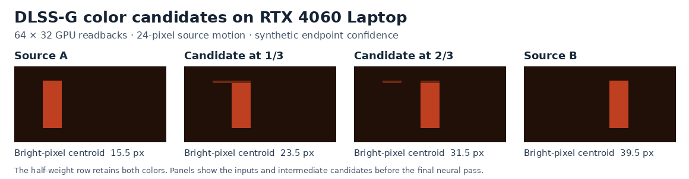

# DLSS Frame Generation and NVIDIA Reflex on Linux (2026-10-18)

## Play the native Ada candidate

On branch `native/mfg`, the Linux RTX 4060 Laptop candidate uses the original
NVIDIA 310.9.1 frame-generation programs and learned weights. At 3x–6x it
computes each intermediate directly from the same two game frames. The
2x setting uses stock NGX. The earliest 4x cascade remains an optional comparison.

Choose **1920×1080, DLSS Quality** (1280×720 render resolution) and launch:

```sh
BB_DLSSG_DIRECT=1 BB_FRAME_GEN=dlss BB_FRAME_GEN_MULTIPLIER=3 ./run.sh
```

Use Insert or L3+R3 to change the multiplier between 2x and 6x. The direct
path runs on the draw queue, uses the game's camera and motion vectors, and
restores HUD pixels from the rendered frame when the HUD-less scene is
available. The first real frame after a reset seeds history. Other resolutions
and presets use the stock multiplier available for the GPU. The tested FG
library is the Linux x86-64 release `libnvidia-ngx-dlssg.so.310.9.1` (SHA-256
`aef4c911831b0381a6afa0164b743138e8571822646b6a4226e810a035ad678e`).

### RTX 4060 Laptop gameplay comparison

A private Iosefka's Clinic save, driver 620.70.06, Reflex On and Immediate
presentation were used on a 165 Hz display. At 3x, a shelf detail crossed
the screen from x=500 to x=397 pixels in one camera turn. In between, it was
at x=466 and x=431, or 33.0% and 67.0% of the displacement. Positions come
from normalized cross-correlation of the same 74×78 patch in four consecutive
presenter input images. On three consecutive source pairs, a larger patch of
the shelves gave phase fractions of 0.336–0.343 and 0.665–0.671. The hood and
face edges looked slightly softer on the generated frames in this sample.
A static capture kept the health-bar detail in place.

| Multiplier | Uncapped source frames/s | Uncapped presenter images/s | FG GPU ms per source pair at 35 FPS | Within-group present interval at 35 FPS |
| --- | ---: | ---: | ---: | ---: |
| Stock 2x | 63.20 | 126.4 | 4.040 | 14.291 ms |
| Direct 3x | 54.77 | 164.27 | 5.943 | 9.535 ms |
| Direct 6x | 40.4 | 242.2 | — | — |

The uncapped comparison counts prepared real frames per elapsed second with
the clinic camera stationary. Presentation rates come from the overlay; the
6x result is a single stable sampling window. The separate 35 FPS run used
Vulkan timestamps around FG and CPU timestamps at `vkQueuePresentKHR` return.
All 602 complete 2x groups contained two returns and all 190 complete 3x
groups contained three. The 3x within-group 95th percentile was 9.734 ms,
and the median from a real frame to the next generated one was 9.541 ms.
Median real-frame flip spacing was 28.625 ms for both settings. Physical
scanout and input-to-photon latency were not measured.

The in-game checks covered all five multipliers, a transition through FG Off,
a Hunter’s Mark reload in the clinic, and normal exit. The same-pair core
tests below also cover camera history. The validated game profile and SDK
version are fixed. Rebuild the profile against the local release with the
[CPU-only profile generator](../tools/dlssg_stage_probe/profile/README.md).

## Upstream NGX frame generation (2026-10-18)

NVIDIA's DLSS Frame Generation runs natively on Linux through the DLSS bridge, on a GeForce RTX 40
or newer with NVIDIA's `libnvidia-ngx-dlssg.so.<version>` from the DLSS SDK (310.7 or newer).
Between each two of the game's frames one generated frame is shown (RTX 40), or up to three
(RTX 50, *Multiplier* 3x/4x). Works with every upscaler (DLSS or FSR) and every preset except Off.

- **Where:** the overlay menu (Insert or L3+R3) → *Frame generation → DLSS (NVIDIA RTX 40/50)*;
  the launcher → *Upscaler → Frame generation*; `BB_FRAME_GEN=dlss`, `BB_FRAME_GEN_MULTIPLIER=2..4`.
  `bbport.ini`: `frame_generation=off|fsr3|dlss`, `frame_generation_multiplier=2..4`.
- **The library:** `DLSS_SDK_ROOT=... bash build.sh` copies it next to `bb-probe` with the Super
  Resolution one (the AppImage carries both); the launcher's *DLSS: NVIDIA's library → Choose a
  file…* takes it too, into `<user>/dlss/`. The game searches both folders.
- **Inputs:** the finished frame (UI included), the frame before its UI, a copy of the scene
  depth, the motion vectors bbport computes (camera and object motion), the jitter and the game's
  cameras as D3D clip-space matrices (`gpu/upscale/camera_matrices.h`, tested without a GPU by
  `camera-matrices-test`). A camera that stood still smeared the generated frames on every turn;
  the matrices let DLSS separate the camera's motion from the objects'.
- **Without it:** on other GPUs, without the library or the bridge, or with `BB_DLSS=0`, the menu
  entry says why, and a saved DLSS choice is kept but does nothing. If a generation fails, the
  real frame is shown twice instead of garbage, and DLSS Frame Generation switches itself off
  with the reason in the menu.
- **Bridge ABI 2** (`gpu/dlss_bridge`, MIT): `FrameGenMaxCount`, `FrameGenCreate`,
  `FrameGenEvaluate`, `FrameGenRelease`, and `ConfigureDirectories` (several folders for NGX to
  search). An ABI 1 bridge still gives DLSS Super Resolution.
- FSR 3.1 frame generation stays hidden until its artifacts are fixed (`BB_FRAME_GEN=1` shows it);
  the presenter now paces up to three generated frames evenly before the real one.

The original implementation follows the Windows port (Supermedo/bloodborne_pc)
and NVIDIA's Linux SDK. The Ada results above include the stock NGX 2x control.

### Experimental 4x cascade on Linux

Set `BB_DLSSG_CASCADE=1 BB_FRAME_GEN=dlss BB_FRAME_GEN_MULTIPLIER=4` with the ABI 4
bridge. In the graphics overlay, choose DLSS and **4x (experimental cascade)**.
The standard 2x option uses the original single feature. Each rendered pair A/B
costs three ordinary NGX evaluations in 4x mode. The first feature makes the
midpoint M. A second feature processes A→M and M→B in sequence. The presenter
receives the quarter frame, M, the three-quarter frame and B in that order.

The half-step motion, depth and camera transforms are estimates from the real
frames. With a HUD-less capture, both features operate on scene color. The
renderer then copies pixels changed by the game's UI from the current finished
frame to each output. Translucent HUD pixels keep some current background.
Both histories restart on reset. The presenter checks the SDK's skip flags
after the source frame's render submission completes and drops a declined group.

#### RTX 4060 Laptop validation

Linux driver 620.70.06 and NVIDIA DLSS SDK 310.9.1. NGX reported
`MultiFrameCountMax=1`. Requesting native multi-output 3x directly through
the public API returned `0xbad00005` (invalid parameter) at the first of the
two requested output indices. The reference Vulkan 2x path placed a textured
object moving 24 pixels per source frame at the 12-pixel midpoint.
[Public capability and index definitions](https://github.com/NVIDIA/DLSS/blob/v310.9.1/include/nvsdk_ngx_defs_dlssg.h#L348-L359)
and [NVIDIA programming guide](https://github.com/NVIDIA/DLSS/blob/v310.9.1/doc/DLSS-FG%20Programming%20Guide.pdf).

Two independent 2x handles on the same Vulkan device produced positions 6, 12
and 18 pixels into that motion in all 17 synthetic pairs at 1080p. This
fixture supplied analytic intermediate depth and motion. The game uses its
own estimated guides. During a fast turn in Iosefka's Clinic, a bright window
moved from x=417.2 to 244.3 pixels across one real pair. Its three generated
positions were 374.8, 332.0 and 287.9, covering 24.5%, 49.3% and 74.8% of
the displacement. Positions are the mean x of pixels with mean RGB above
80/255 in x=[100,550), y=[285,430) of the 1920×1080 presenter input.
The health bar and item icons stayed in place. The generated frames showed
blocky edges where the moving collar met the face in this close-up.

The 1080p diagnostic comparison used the same clinic save, DLSS Quality
(1280×720 source), Reflex On, Immediate presentation and a 35 FPS source cap.
The 2x executable and bridge used upstream 0.7 at `0fc2921`. Both builds
used the same FSR dependency link fix. The cascade measurement used `f4f9090`.

| Static clinic window | Upstream 2x | Cascade 4x |
|---|---:|---:|
| Source flips/s | 34.94 | 34.94 |
| Present returns/s | 69.87 | 139.74 |
| Return interval, median / p95 | 14.31 / 14.64 ms | 7.15 / 7.39 ms |
| FG GPU label, median across full five-second windows | 4.03 ms/source | 9.73 ms/source |

Rates use the first and last timestamps of each event type in the static window.
The built-in timeline records a source flip at `Display::Flip` and a return on
the CPU immediately after `vkQueuePresentKHR`. GPU label times use the renderer's
Vulkan timestamps. The experiment measured application pacing. Panel scanout and
input-to-photon latency were outside the capture.

With the 35 FPS cap removed, the final ABI 4 build (`0fa5f6a`) ran both modes
in the same process at the same stationary clinic view. With the menu closed
and the heavyweight profilers disabled, six complete five-second windows per
mode yielded **60.05 source frames/s at 2x** (1,803 prepared in 30.025 s) and
**47.09 at 4x** (1,414 in 30.030 s). The existing overlay render counter
averaged 120.07 and 188.35 calls/s respectively. The display ran at 165 Hz.
For a 35 FPS target the 4x mode kept the same source speed in this scene.
The first unrestricted 4x window had 22% fewer source frames/s than 2x.
After switching back to 4x, a further nine complete windows (45.029 s) gave
39.57 source frames/s and 158.21 overlay calls/s at the same view. The cause
of the lower second 4x rate is unresolved. Fixed-view compositor screenshots
showed stable shelf and HUD detail; their frame type was unspecified.

The in-game 4x→2x→Off→4x sequence resumed generation at each selected rate.
Using the Hunter's Mark reloaded the clinic in the same process. The new
camera view and HUD appeared and 4x generation resumed. The tests used a
private save and exited normally.

#### Direct multi-output on the RTX 4060 Laptop

The `nrbridge` reference binds the current real frame, its depth and motion
once per pair. Its Windows helper uses the same feature for each output index.
It applies a version-specific adaptation to the loaded Windows feature
module. The Linux experiment below used the original NVIDIA Linux modules.

| Linux DLSS-G module | Single-feature test on driver 620.70.06 | Result |
|---|---|---|
| 310.9.1 development | 2x control, then a separate 3x run | Correct moving midpoint at 2x. NGX rejected the first 3x index. |
| 310.9.1 release | Requested two generated frames at create, supplied a consecutive real backbuffer ID, primed the feature with three 2x evaluations, then requested 3x | Warm 2x succeeded. NGX rejected count 2, index 1 on source frame 4. |
| 310.9.16 release | Same warm test using the matching headers, Linux NGX stub and feature libraries | Warm 2x succeeded. Same rejection on source frame 4. |

Each 3x request returned `0xbad00005` with the runtime reporting a supported
count of one. No direct 3x image was produced. The 4x–6x direct cases were
left unmeasured. [NVIDIA 310.9.16 release](https://github.com/NVIDIA/DLSS/releases/tag/v310.9.16)

The Windows and Linux release modules at 310.9.1 share 31 byte-identical
embedded Blackwell PTX payloads in containers that also have Ada members.
A separate compile-only test extracted these from the Linux file, targeted
Ada in memory, and compiled all 31 into CUDA objects on the RTX 4060 Laptop.
This compile-only test launched zero kernels. The stage experiments below
also execute selected GPU programs. The independent full-model result is recorded below.

A separate 2x test traced Vulkan calls through the two procedure resolvers
passed to NGX at initialization. It used the upstream bridge at `0fc2921`,
the stock Linux 310.9.1 release and the same 24-pixel motion fixture. The
centroid moved from 335.5 to 359.5 pixels and the generated image measured
347.5. Feature creation made 64 NVX CUDA functions. Eight ordinary evaluations
recorded 616 `vkCmdCuLaunchKernelNVX` calls, with another 10 on reset.
Creation exposed names for intermediate motion estimation, network input and
blending. The trace counted launches without identifying the function at each
launch. The 31 PTX entry points checked above each accept a single packed
argument block. The public NGX interface selects a time using the frame count
and index. The resolver trace revealed no separate way for the application to
select a fractional time. The CUDA NGX evaluate export in the 310.9.1 Linux
release simply returns `NVSDK_NGX_Result_FAIL_FeatureNotSupported`.

#### Which calculations run on Ada?

NVIDIA describes a network that caches work for the rendered pair and then
evaluates a smaller network for each requested time. The public NGX Vulkan
interface takes the current rendered input, retains history in the feature,
and selects an output by count and index. Its outputs are images and the skip flag. The
public interface does not expose the pair cache or a standalone evaluator for
the second network. [DLSS 4 research report, §2.2.1](https://research.nvidia.com/labs/adlr/DLSS4/#221-architectural-changes)
· [Vulkan FG interface](https://github.com/NVIDIA/DLSS/blob/v310.9.1/include/nvsdk_ngx_helpers_dlssg_vk.h)

The Linux and Windows 310.9.1 release modules also share 39 byte-identical
Ada PTX programs in containers with no other architecture. These include
convolutions, pooling and upsampling. The comparison hashes decompressed PTX
including duplicate entry names. It compares GPU programs only. The weights
and tensor layouts used by the complete models have yet to be matched.

At 1280×720 the stock Linux 2x feature recorded 77 named Vulkan NVX CUDA
launches per steady evaluation. Six instrumented frames followed the same
order. The timing column is the median sum of the observed GPU timestamp
intervals in each group. The intervals include intervening GPU work.

| Zero-based launches | Work observed at 2x | GPU time |
|---|---|---:|
| 0–41 | Input color, endpoint motion, first convolution and its outputs | 0.706 ms |
| 42–44 | Intermediate motion, confidence warp and color candidates | 0.140 ms |
| 45–72 | Initial merge, convolution blocks and upsampling | 1.129 ms |
| 73–76 | Output reconstruction | 0.155 ms |

Alternate steady frames had either two outer timestamps or an additional
timestamp after each launch. The median total was 2.011 ms with outer
timestamps and 2.188 ms with the detail enabled (six samples each). Two
detailed samples exceeded 8 ms. Reuse and timings at 3x require a full 3x run.

In isolation, the **original Ada motion kernel** from the Linux release
projected a 32×32 input correctly at three times. The two source positions
were (10, 20) and (22, 14) pixels. The motion and depth inputs were held
fixed. Only the requested fractional time changed. Each entry below is the
displacement from the intermediate location back to the named source.

| Time | To previous, px | To current, px |
|---|---:|---:|
| 1/3 | (−4, 2) | (8, −4) |
| 1/2 | (−6, 3) | (6, −3) |
| 2/3 | (−8, 4) | (4, −2) |

Both sources covered all 64 samples of the central region with zero vector
error. A separately tracked depth marker reached the expected grid cell at
each time. The Blackwell PTX compiled for Ada gave the same measured values.

Three **unmodified Ada kernels** from launches 42–44 were then run together
on a 64×32 stripe moving 24 pixels horizontally. Two CUDA motion fields from
the first kernel supplied the Vulkan stages unchanged through private fixture
files. The second kernel projected synthetic endpoint confidence values. The
third consumed its weight image and the real input colors to produce two
candidate images. At 1/3, 1/2 and 2/3, the bright pixels in **both** candidates
were centered at 23.5, 27.5 and 31.5 pixels. The source centers were 15.5 and
39.5. All 2048 pixels in both weight channels, both color candidates, the mask
and their packed outputs matched the fixture reference at each time. One row
intentionally used a blending weight of 0.5. The figure shows the first color
candidate at each third using nearest-neighbor enlargement.



Run `tools/dlssg_stage_probe/run.sh` in a full clone of this fork on the
4060 to reproduce the offscreen geometry test. It uses the Linux x86-64
310.9.1 release in `$DLSS_SDK_ROOT` (defaults to `out/deps/dlss-sdk`),
a C++20 compiler, Vulkan, liblz4 and Python 3.10+. The script builds under
the main checkout's `out/native-mfg`, takes the project GPU lock, then cleans
up. Set `BB_MFG_FIXTURE_RGB` to an existing private directory to save four
small PPM readbacks. No game or save data is required.

The test supplies its own endpoint confidence instead of the first network's
learned output and stops before the final convolution and reconstruction.
The 310.9.1 development SDK also named 175 buffers, 30 images and 30 image
views during feature creation using one generic resource name. Its evaluation
label covered the entire feature. Neither gave a layout or lifetime for the
cached pair tensors. The independent executor below reconstructs that connection on its own device resources.

#### Independent execution of the original neural networks

Two offscreen executors used the original Ada programs and parameters from
the 310.9.1 Linux release. Neither called NGX. A stock 1280×720 evaluation
provided the program identities, launch sizes and tensor shapes for comparison.
All weights were read from the local SDK. No model payload is distributed here.

* The pair network ran 32 operations using 17 packed coefficient buffers.
  With a zero input and a periodic input it produced distinct, finite tensors
  of 983,040 FP16 values. Repeating the zero input reproduced the entire first
  output bit for bit.
* The phase network ran the merge and 27 subsequent operations using 25 sets
  of weights and biases. Its 640×368 input had ten FP16 channels. The original
  merge consumed the two packed candidates and their mask. The 2x reference
  supplied 0.5 as its final scalar. The network produced a 640×368 eight-channel
  tensor shared with the first output reconstruction stage through the same
  Vulkan buffer.
* In the isolated phase-network test, three synthetic candidate displacements
  produced three different tensors, with all 1,884,160 output values finite.
  Repeating the first displacement reproduced its tensor bit for bit. This
  test kept the merge scalar at 0.5. In a smaller independent check, all
  16,384 features from the first learned convolution agreed with a CPU
  calculation using the same weights to a maximum absolute error of 0.000733.

#### Whole-frame result on Ada

On the RTX 4060 Laptop the independent executor reproduced all four stock NGX
1280×720 images exactly, including reset and successive history frames. Both
the SHA-256 and FNV-1a digests of every RGBA image matched. For a red object
moving from 359.5 to 383.5 pixels, the independent program placed its 1/3 and
2/3 images at 368.0 and 376.0 pixels (expected 367.5 and 375.5). The measured
center is the mean x of the pixels passing the original red threshold.

The player core prepares each source pair once. For each output it reruns
the phase-dependent part with the corresponding time and a separate image.
The stock 2x workload reuses a motion texture as scratch for confidence
weights once it has consumed motion. A second phase needs the original motion
again. The core keeps the weights in one separate texture for the whole group.
At both 720p and 1080p Quality, all fifteen phases across 2x–6x appeared in
order; the next real-frame pair also reproduced its stock 2x reference after
every multiplier. On the 1080p test the maximum centroid deviation was 0.94
pixels. The 1080p camera-change frame, with translation, jitter and inverted
depth, also matched the original RGBA digest.

## Low latency: NVIDIA Reflex through VK_NV_low_latency2 (2026-10-18)

On NVIDIA's driver (550 and newer) the game's thread sleeps at the start of each of its frames
until the driver wants the frame started (`vkLatencySleepNV`, at the frame-rate hooks' pacer
step; without the hooks right after the flip), and the frame's simulation, render submissions and
present carry one ID through the driver's markers, `VkLatencySubmissionPresentIdNV` and
`VK_KHR_present_id`. Generated frames are presented out of band. `gpu/render/vk_low_latency`.

- *Overlay menu → Output → Low latency (NVIDIA Reflex)* and the launcher: Off, On (default where
  available), On + Boost. `bbport.ini`: `low_latency=off|on|boost`; `BB_LOW_LATENCY`. With DLSS
  frame generation it is always at least On (the overlay shows that and greys Off out; the
  launcher's row follows). Nothing changes on GPUs and drivers without the extension; the entry
  says so on an NVIDIA GPU with an old driver.
- Not yet measured on hardware by the author; what to compare on an RTX card: input lag with the
  setting Off and On at the same frame rate, with and without frame generation.

## Русский

Генерация кадров DLSS (DLSS Frame Generation) работает нативно на Linux через мост DLSS, на
GeForce RTX 40 и новее с библиотекой NVIDIA `libnvidia-ngx-dlssg.so.<версия>` из DLSS SDK (310.7
или новее). Между каждыми двумя кадрами игры показывается один сгенерированный (RTX 40) или до
трёх (RTX 50, *Множитель* 3x/4x). Работает с любым апскейлером (DLSS или FSR) и любым пресетом,
кроме «Выкл».

- **Где:** меню-оверлей (Insert или L3+R3) → *Генерация кадров → DLSS (NVIDIA RTX 40/50)*;
  лаунчер → *Апскейлер → Генерация кадров*; `BB_FRAME_GEN=dlss`, `BB_FRAME_GEN_MULTIPLIER=2..4`.
  `bbport.ini`: `frame_generation=off|fsr3|dlss`, `frame_generation_multiplier=2..4`.
- **Библиотека:** `DLSS_SDK_ROOT=... bash build.sh` копирует её рядом с `bb-probe` вместе с
  библиотекой Super Resolution (AppImage несёт обе); в лаунчере её можно выбрать так же, *DLSS:
  библиотека NVIDIA → Выбрать файл…*, в `<user>/dlss/`. Игра ищет в обеих папках.
- **Входы:** готовый кадр (с интерфейсом), кадр до интерфейса, копия глубины сцены, векторы
  движения bbport (камера и объекты), jitter и камеры игры в виде матриц clip-пространства D3D
  (`gpu/upscale/camera_matrices.h`, тест `camera-matrices-test` без GPU).
- **Без неё:** на других видеокартах, без библиотеки или моста, с `BB_DLSS=0` пункт меню говорит,
  почему недоступен; сохранённый выбор DLSS остаётся, но ничего не делает. Если генерация не
  удалась, вместо мусора дважды показывается настоящий кадр, и генерация DLSS выключается с
  причиной в меню.
- **ABI 2 моста** (`gpu/dlss_bridge`, MIT): `FrameGenMaxCount`, `FrameGenCreate`,
  `FrameGenEvaluate`, `FrameGenRelease` и `ConfigureDirectories`. Мост ABI 1 по-прежнему даёт
  DLSS Super Resolution.
- Генерация кадров FSR 3.1 остаётся скрытой, пока не исправлены её артефакты (`BB_FRAME_GEN=1`);
  презентер теперь показывает до трёх сгенерированных кадров равномерно перед настоящим.

На железе автором не проверено (нет видеокарты NVIDIA под рукой): путь Vulkan повторяет рабочую
реализацию порта для Windows (Supermedo/bloodborne_pc) и SDK NVIDIA для Linux; нужны отчёты
владельцев RTX 40/50.
